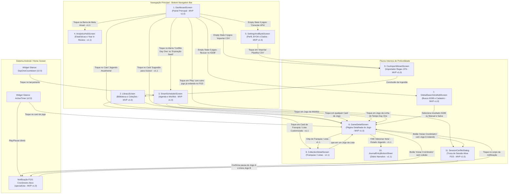

# Especificação de Telas, Arquitetura de Navegação e Fluxos de Ação (UI/UX)

**Projeto:** Gecko — Aplicativo Móvel Nativo (Android)  
**Versão:** 1.1 (Alinhada ao SRS v2.1, DAS v1.0 e Matriz MoSCoW de Releases)  
**Stack de UI:** Jetpack Compose (Material Design 3 — OLED Dark Theme + Tonal Elevation)  
**Referências Visuais:** Tonkatsu Box (densidade de grelhas/detalhes), Letterboxd / StoryGraph (diários narrativos) e Steam (filtros e badges de licença).

---

## 1. Visão Geral da Navegação e Topologia Global

O aplicativo adota uma estrutura de navegação em barra inferior (**Bottom Navigation Bar** — 4 abas no **MVP v1.0** expandindo para 5 abas na **v1.1** com a entrada do `AnalyticsHubScreen`) combinada com barra superior contextual (**TopAppBar**) e superfícies modais (**ModalBottomSheet**, **Dialogs** e **Notificações de Foreground Service**).

---

## 2. Governança de Escopo por Release (Matriz MoSCoW e Feature Flags)

Para evitar sobrecarga de escopo (*scope creep*) na **Sprint 1 (MVP v1.0)**, a camada de apresentação utiliza um objeto central de configuração (`ReleaseFeatureFlags`) injetado via Hilt nas ViewModels. Componentes de releases futuras permanecem ocultos ou desacoplados até seu ciclo correspondente:

| Release / Nível MoSCoW | Escopo de Telas e Componentes Ativos na UI | Componentes Ocultos / Protegidos por Feature Flag |
| :--- | :--- | :--- |
| **MVP Essencial (`v1.0` — *Must Have*)** | • **`DashboardScreen`**: Estado Vazio Inicial (*Onboarding*), Cards de `Jogando Atualmente`, alertas de conflito *Day One*, KPIs essenciais (Total Zerados, Horas Totais, Nota Média — RF17) e ajuste de Disponibilidade Diária (RF02). • **`LibraryScreen`**: Grade/Lista de jogos por estado (RF20) e badges `Possuo` vs. `SaaS` (RF10). • **`GameDetailScreen`**: Máquina de estados, estilo `Rushar/Normal/Platina` (RF06), *Delta Baseline* (RF07), Cronômetro FGS com trava de sessão única (RF21) e Avaliação `0.00–11.00` (RF22). • **`SmartSchedulerScreen`**: Fila preditiva ponderada (RF15), Modo Hora Extra (RF15.1) e toggle *Day One* (RF13). • **`SettingsAndByokScreen`** + **`CsvImportWizardScreen`**: Cofre BYOK (RF01), fallback HLTB (RF01.1) e importação Regex CSV (RF09). | • Ocultar barra de Meta Anual (RF03), FAB de Diário (RF23.1), botão de Replay 1:N (RF23) e aba `AnalyticsHubScreen` (RF18). • Ocultar gaveta de filtros dinâmicos da Wishlist (RF12.1), pastas de Franquias/Listas (RF19/RF27) e exportação SAF (RF28). • Ocultar Custo por Hora (RF26), Calibração Pessoal (RF24), alertas de expiração SaaS (RF25) e Widgets Glance (RNF06). |
| **Expansão (`v1.1` — *Should Have*)** | • Desbloqueia **`AnalyticsHubScreen`** (RF18) e barra de **Meta Anual** no Dashboard (RF03). • Desbloqueia **Múltiplos Playthroughs / Replays** (RF23) e **FAB Contextual de Diário (`JournalEntryBottomSheet`)** (RF23.1). • Desbloqueia **Sugestão para Usuário Ocioso** ($N=0$ — RF16), **Calendário com datas imprecisas** (RF14) e **Gaveta de Filtros da Wishlist** (RF12.1). • Desbloqueia **Pastas de Franquias** (RF19), **Listas Customizadas** (RF27), **RetroAchievements** (RF08), **Restrição Oficial de Plataformas IGDB** (RF04), **Ciclo OAuth2 60 dias da PSN** (RF01.2) e **Exportação CSV/JSON** (RF28). | • Manter ocultos sob flag `ENABLE_V2_FEATURES = false`: Módulo Financeiro Opt-in (RF26), Calibração Comportamental Automática (RF24), Monitoramento de Expiração de Catálogos SaaS (RF25) e Receivers de Widgets Jetpack Glance (RNF06). |
| **Evolução (`v2.0` — *Could Have*)** | • Ativa `ENABLE_V2_FEATURES = true`. • Desbloqueia **Módulo Financeiro Opt-in (`Custo por Hora R$/h`)** na `SettingsAndByokScreen`, `GameDetailScreen` e `AnalyticsHubScreen` (RF26). • Desbloqueia **Indicador de Calibração Pessoal (`0.80x` / `1.25x`)** (RF24). • Desbloqueia **Alertas Push e In-App de Expiração de Assinaturas SaaS** (RF25). • Registra os **Widgets de Tela Inicial via Jetpack Glance** (RNF06). | *Escopo integral v2.1 habilitado.* |

---

## 2.1. Regra de Negócio Transversal RN-BKL-01: Backlog Visível vs. Backlog Elegível `[MVP v1.0 — Obrigatória]`

> [!IMPORTANT]
> **Jogos `Pausado` e `Abandonado` APARECEM no Backlog da `LibraryScreen`, mas NUNCA participam das funções que consomem o Backlog como fonte de sugestão ou planejamento.**
> Esta regra deve ser respeitada em qualquer implementação (DAO, Repository, Use Case, ViewModel). Toda função nova que leia "jogos do Backlog" deve declarar explicitamente qual dos dois conjuntos abaixo utiliza.

| Conjunto | Estados incluídos | Onde é usado |
| :--- | :--- | :--- |
| **Backlog Visível** (`BACKLOG_VISIBLE_STATUSES`) | `Backlog / Possuo` + `Pausado` + `Abandonado` | **Somente exibição:** cartão/filtro `Backlog` da `LibraryScreen` (contagem e grade), atalho `"Escolher jogo do Backlog"` do Dashboard (MVP), busca local da biblioteca. |
| **Backlog Elegível** (`BACKLOG_ELIGIBLE_STATUSES`) | **Apenas** `Backlog / Possuo` (licença `Possuo` ou `SaaS` ativa; nunca `Quero Comprar` — RF11) | **Toda lógica de sugestão/planejamento:** card **"Janela Livre até o Próximo Day One"** (RF16), **Recomendações de Janela Livre** da `SmartSchedulerScreen` (RF15 Cenário B), sugestões rápidas do alerta de conflito *Day One* (RF15 Cenário A), fila preditiva (`CalculateSmartScheduleUseCase`), widgets Glance (RNF06) e qualquer futura recomendação automática. |

**Diretrizes de implementação (não negociáveis):**
1. **Domínio puro:** Os dois conjuntos são constantes do `domain/` (ex.: `object BacklogPolicy { val VISIBLE = setOf(BACKLOG, PAUSED, ABANDONED); val ELIGIBLE = setOf(BACKLOG) }`), sem dependências Android.
2. **Use Case dedicado:** Funções de sugestão obtêm candidatos exclusivamente via `GetEligibleBacklogGamesUseCase` (filtro `status IN BacklogPolicy.ELIGIBLE`). É proibido reutilizar a query/Flow da `LibraryScreen` (Backlog Visível) como fonte de sugestões.
3. **Query explícita:** No DAO, a consulta de elegíveis filtra por `status = 'BACKLOG'` de forma explícita. Nunca usar `status != 'ZERADO'`, `status NOT IN (...)` ou "tudo que não é Jogando" — novos estados não podem vazar para as sugestões por omissão.
4. **Diferenciação visual:** Na grade do Backlog, jogos `Pausado` exibem ícone de pausa laranja (`#F59E0B`) e `Abandonado` ícone/badge cinza dessaturado, para o usuário entender por que não aparecem nas sugestões. A gaveta `Filtros` da `LibraryScreen` permite isolar `Pausado` e `Abandonado` dentro do Backlog.
5. **Reentrada:** Um jogo só volta a ser elegível quando o usuário o transiciona manualmente de volta para `Backlog / Possuo` (ou para `Jogando Atualmente` via `Retoma` / `Tenta Novamente`). Nenhuma rotina automática altera esse estado.
6. **Teste obrigatório:** `GetEligibleBacklogGamesUseCaseTest` deve garantir que um banco com jogos `BACKLOG`, `PAUSED` e `ABANDONED` retorna apenas os `BACKLOG`, e um teste do motor RF16 deve provar que um jogo `Pausado` com duração HLTB compatível com a janela **não** é sugerido.

---

## 3. Catálogo Detalhado de Telas e Componentes

### 3.0. Tela 0: Fluxo de Boas-Vindas e Configuração Inicial (`WelcomeOnboardingScreen`) `[MVP v1.0]`
**Rota:** `welcome_onboarding` *(Exibida apenas no primeiro acesso antes do `DashboardScreen`, controlada por flag local `isFirstLaunchCompleted`)*  
**Requisitos Atendidos:** RF01, RF01.1, RF02, RF03 (v1.1), RF06, RF09, RNF03, TUI-02.  
**Propósito:** Receber o usuário com uma animação fluida e configurar em 3 passos rápidos o perfil local, o ritmo diário de jogo e as chaves de API (BYOK), garantindo que ao entrar no `DashboardScreen` o aplicativo já esteja 100% calibrado e sincronizando a biblioteca em segundo plano.

#### Estrutura do Wizard (3 Passos com `HorizontalPager` + Indicador de Progresso no Topo):
1. **Passo 1 de 3 — Animação de Boas-Vindas e Perfil Local (`OnboardingProfileStep` — RF01):**
   - **Animação de Entrada:** Halo concêntrico pulsante em verde esmeralda (`InfiniteTransition` suave em Compose) envolvendo a mascote do Gecko (`Bem-vindo ao Gecko — Seu diário e planejador inteligente de jogos`).
   - **Foto de Perfil (Opcional):** Seletor circular central (`AvatarPhotoPicker`) exibindo a inicial do nome por padrão e um botão flutuante de câmera (`📷`) que aciona o `ActivityResultContracts.PickVisualMedia` nativo do Android para escolher uma foto da galeria local.
   - **Campo Nome ou Apelido:** Campo limpo (`"Seu nome ou apelido"`) com validação instantânea (`✓`) e aviso tranquilizador de privacidade: `"🔒 Salvo apenas no seu aparelho, sem conta em nuvem"`.
2. **Passo 2 de 3 — Ritmo Diário, Estilo Padrão e Meta (`OnboardingPaceStep` — RF02, RF06, RF03):**
   - **Seletor Principal de Ritmo Diário (RF02):** Display grande (`2h 00m por dia (~14h por semana)`) com botões `−` / `+` (incrementos de 15m/30m) e *chips* de atalho (`1h 00m`, `1h 30m`, `2h 00m`, `3h 00m+`).
   - **Simulador Instantâneo em Linguagem Natural:** Caixa dinâmica que reage ao valor selecionado mostrando: `"✦ Nesse ritmo, um jogo de 20h leva ~10 dias"`.
   - **Seletor de Estilo de Jogo Padrão (RF06):** 3 cartões selecionáveis lado a lado: `⚡ Rushar (Foco na história)`, `🎮 Normal (História + Extras)` e `🏆 Platina (100% / Troféus)`.
   - **Meta Anual Opcional (RF03 — v1.1):** Pílulas rápidas (`12 jogos`, `24 jogos`, `36 jogos`, `Outro`) para já definir a meta do ano corrente.
3. **Passo 3 de 3 — Conexões de Plataformas e Importação (`OnboardingConnectionsStep` — RF01, RF09, RNF03):**
   - **Botão `"Pular por enquanto ›"` no topo direito:** Garante que usuários do *Perfil A (Modo Offline Puro — RF01.1)* entrem direto no app sem qualquer bloqueio.
   - **Cards Expansíveis de Plataformas (BYOK com Máscara Automática `••••••••` — TUI-02):**
     - **IGDB (Catálogo e Capas Oficiais):** Campos `Client ID` e `Client Secret` com selo `✓ Conectado`.
     - **PlayStation Network (PSN):** Campo para o cookie `npsso` com botão `"Validar ✓"` e aviso amigável `"🔄 Renovação automática ativa por 60 dias"`.
     - **Steam (Biblioteca PC e Horas):** Campos `Web API Key` e `SteamID64`.
     - **RetroAchievements & RAWG (Opcional):** Linha compacta expansível (`+ Configurar`).
   - **Atalho de Migração Rápida (RF09):** Card `"📄 Tem uma planilha de jogos zerados? Importar arquivo CSV agora ›"`.
   - **Botão Final (`"Entrar no Gecko tudo pronto →"`):** Salva as credenciais no `EncryptedSharedPreferences / Android Keystore`, dispara os *Workers* iniciais de sincronização em segundo plano e navega para a **`DashboardScreen`** já populada e configurada.

---

### 3.1. Tela 1: Dashboard Principal (`DashboardScreen`)
**Rota:** `dashboard`  
**Requisitos Atendidos:** RF02, RF15, RF15.1, RF17, RF21 *(MVP v1.0)* | RF03, RF16 *(v1.1)* | RF25 *(v2.0)*.  
**Propósito:** Centro de comando diário do jogador. Adapta-se reativamente a três estados de população de dados: **Primeiro Acesso Absoluto (0 jogos no banco)**, **Campanhas Ativas ($N \ge 1$)** e **Usuário Ocioso ($N = 0$ ativos, mas com biblioteca cadastrada)**.

#### Anatomia Visual e Componentes:
1. **Top Bar de Busca e Perfil `[MVP v1.0]`:**
   - Barra de pesquisa rápida estilo *search bar* ("Comece a digitar para buscar...") com atalho de engrenagem/avatar à direita.
2. **Estado A — Primeiro Acesso Absoluto (`EmptyLibraryOnboardingCard` — Total de Jogos no SQLite $= 0$) `[MVP v1.0]`:**
   - **Condição de Exibição:** Renderizado exclusivamente quando `totalGamesInDb == 0` (substituindo os painéis analíticos zerados e a fila preditiva vazia).
   - **Visual:** Card central amplo com *Tonal Elevation* M3, ilustração vetorial minimalista da mascote Gecko em alto contraste OLED, título **"Sua biblioteca Offline-First começa aqui"** e subtítulo explicando que todos os dados residem localmente no dispositivo.
   - **3 Botões de Ação Direta (*Call-to-Actions*):**
     1. **Botão Primário Preenchido (`FilledButton`): `"Importar Histórico de Planilha (CSV)"`** — Redireciona diretamente para a `CsvImportWizardScreen` (RF09) para migrar anos de jogos zerados em segundos.
     2. **Botão Secundário Tonal (`FilledTonalButton`): `"Buscar Primeiro Jogo (IGDB / Manual)"`** — Abre a `GlobalSearchAndAddScreen` com foco imediato no teclado.
     3. **Botão Terciário Contornado (`OutlinedButton`): `"Configurar Chaves de API (Steam / PSN / BYOK)"`** — Navega para a seção de credenciais na `SettingsAndByokScreen` (RF01).
   - **Configuração Rápida Embutida:** Seletor inicial da **Disponibilidade Diária** (ex.: `2h 00m/dia` — RF02) para já deixar o *Smart Scheduler* calibrado.
3. **Banner de Alertas Proativos (Condicional — Quando `totalGamesInDb > 0`):**
   - **Alerta de Conflito *Day One* `[MVP v1.0 — RF15 Cenário A]`:** Aparece quando a data projetada de término de um jogo ativo ultrapassa a estreia de um título marcado como *Day One*. Exibe sugestões rápidas: *"Mudar para Rushar"*, *"Pausar concorrente"* ou *"Ajustar cota diária"*. Um jogo pausado por esta ação sai das sugestões até ser retomado (RN-BKL-01).
   - **Alerta de Expiração de Assinatura `[v2.0 — RF25]`:** Aparece quando um jogo em `Assinatura Temporária (SaaS)` tem data de saída próxima do catálogo (PS Plus / Game Pass), destacando a meta diária mínima necessária (`horas_diarias_necessarias = tempo_restante / dias_ate_expiracao`).
4. **Seção "Jogando Atualmente" — *Caso de Uso Central* `[MVP v1.0]`:**
   - **Estado B — Com Campanhas Ativas ($N \ge 1$ jogos em `Jogando Atualmente`):**
     - **Como é o Card do Jogo Atual:**
       - **Visual:** Card horizontal de alta proeminência com *Tonal Elevation* (superfície M3 sobre fundo preto OLED), imagem de capa (*boxart*) à esquerda com *badge* da plataforma no topo (ex.: `PS5`, `Steam`, `Switch`) e *badge* de licença (`Possuo` em tom neutro/sólido vs. `SaaS / Assinatura` em cor de destaque — TUI-01).
       - **Dados Exibidos:** Título do jogo, chip do estilo ativo (`Rushar`, `Normal` ou `Platina`), tempo total consolidado via *Delta Baseline* (`platform_reported_time_ms + local_logged_time_ms` formatado ex.: `22h 25m / 35h HLTB`), barra de progresso linear e **Data Projetada de Término** calculada pelo *Peso de Atenção Ponderado* (`Cota_Efetiva = Disponibilidade_Diaria / N`).
       - **Modo Hora Extra (*Overtime* — RF15.1):** Se o tempo jogado ultrapassar a média do HLTB, a barra assume cor especial de extensão ("Hora Extra") sem jamais exibir números negativos.
       - **Ação Rápida Embutida (`Play / Pause`):** Botão circular à direita do card para disparar ou pausar o cronômetro (`ActiveSessionForegroundService`) diretamente sem sair do Dashboard. Caso outro jogo já esteja com o cronômetro rodando, aciona o diálogo de concorrência (`SessionConflictDialog` — ver Seção 3.7.D).
   - **Estado C — Usuário Ocioso ($N = 0$ jogos ativos, mas `totalGamesInDb > 0`):**
     - **No MVP (`v1.0`):** Exibe card compacto *"Nenhuma campanha ativa no momento"* com botão `"Escolher jogo do Backlog"` (que leva à `LibraryScreen` filtrada em `Backlog`).
     - **Na Expansão (`v1.1` — RF16):** Exibe automaticamente o card inteligente **"Janela Livre até o Próximo Day One"**, informando o saldo de horas disponíveis até o próximo lançamento e listando um carrossel de jogos com licença `Possuo` (isolando `Quero Comprar` — RF11) cuja duração HLTB cabe exatamente nessa janela. **Fonte exclusiva: Backlog Elegível (RN-BKL-01)** — jogos `Pausado` e `Abandonado` nunca entram neste carrossel.
5. **Seção "Resumo Analítico e Meta Anual" (`totalGamesInDb > 0`):**
   - **Grid de Indicadores Rápidos (KPIs) `[MVP v1.0 — RF17]`:** 3 cartões compactos lado a lado exibindo: **Total de Jogos Zerados**, **Horas Totais Acumuladas** e **Média Geral de Avaliações** (omitindo cartões punitivos de "jogo mais longo/rápido").
   - **Card de Meta Anual `[v1.1 — RF03]`:** Barra de progresso percentual e contador absoluto (ex.: `14 / 24 jogos zerados em 2026`).
6. **Card Resumo "Vitrine" (`VitrinePreviewCard` — Baseado em `vitrine1.jpeg`) `[v1.1 — RF14.1]`:**
   - **Visual:** Card com *Tonal Elevation* exibindo ícone de destaque à esquerda (`✦`), título **"Vitrine"**, subtítulo **"O que está saindo agora nos jogos"** e seta indicativa (`›`) à direita.
   - **Fileira de 4 Capas em Miniatura:** Exibe lado a lado os 4 próximos lançamentos (ex.: *Grand Theft Auto VI*, *Tomb Raider: Legacy*, *Azur Promilia*, *Hela*) com a contagem regressiva curta na base de cada pôster (`em 1d`, `em 5d`, `em 8d`, `em 13d`) e borda esmeralda nos títulos já marcados como `Day One`.
7. **Controle Rápido de Disponibilidade Diária (`SmartSchedulerWidget` In-App) `[MVP v1.0 — RF02, TUI-03]`:**
   - Chip interativo exibindo a cota configurada (ex.: `2h/dia`). Ao tocar, abre seletor rápido de horas/minutos que recalcula instantaneamente todas as datas projetadas na tela em `< 200ms` sem recarregar a hierarquia (TUI-03).

#### Fluxos de Ação a partir do `DashboardScreen`:
- **Toque nos CTAs do Estado Vazio (`totalGamesInDb == 0`):** Navega diretamente para `CsvImportWizardScreen`, `GlobalSearchAndAddScreen` ou `SettingsAndByokScreen`.
- **Toque no corpo do Card de Jogo Atual (ou Card de Sugestão Ociosa):** Navega diretamente para a **`GameDetailScreen` (`game_detail/{gameId}`)** dentro da biblioteca, abrindo a ficha completa do título.
- **Toque no cabeçalho do Card "Vitrine" (`VitrinePreviewCard`):** Navega diretamente para a **`VitrineScreen` (`vitrine_releases`)**, abrindo a lista completa de próximos lançamentos (`vitrine2.jpeg`).
- **Toque direto em uma das 4 miniaturas de capa dentro do Card "Vitrine":** Abre diretamente a **`GameDetailScreen` (`game_detail/{gameId}`)** daquele lançamento para ver detalhes ou ativar o marcador `Day One`.
- **Toque no botão `Play` dentro do Card de Jogo Atual:**
  - *Se nenhum cronômetro estiver rodando:* Inicia imediatamente o `ActiveSessionForegroundService` (RF21), muda o ícone do card para `Pause` com contador vivo e fixa a notificação persistente na barra do Android.
  - *Se outro jogo (Jogo A) já estiver sendo cronometrado no FGS:* Exibe o **`SessionConflictDialog`** perguntando se deseja salvar/pausar a sessão do Jogo A e iniciar a do Jogo B.
- **Toque no Banner de Alerta (*Day One* ou *SaaS*):** Navega para a **`SmartSchedulerScreen`** focada na resolução do conflito de agenda.
- **Toque no Card de Meta Anual `[v1.1]`:** Navega para a **`AnalyticsHubScreen`** filtrada no ano civil corrente.

---

### 3.1.1. Tela 1.B: Vitrine Completa de Lançamentos (`VitrineScreen` — Baseada em `vitrine2.jpeg`) `[v1.1 — RF14, RF14.2]`
**Rota:** `vitrine_releases` *(Acessada ao tocar no cabeçalho do card `Vitrine` no Dashboard)*  
**Requisitos Atendidos:** RF13, RF14, RF14.1, RF14.2, RF15.1.  
**Propósito:** Apresentar a visão expandida e detalhada de todos os jogos que estão saindo agora e futuros lançamentos, permitindo filtrar, buscar e marcar títulos como `Day One` ou `Quero Comprar`.

#### Anatomia Visual e Componentes:
1. **Top Bar de Navegação:** Botão circular Voltar (`←`) que retorna ao `DashboardScreen` e título **"Vitrine"**.
2. **Barra de Busca Interna e Controles:**
   - Campo de pesquisa arredondado (`"O que está saindo agora..."`), botão circular de atualização manual (`↻` — sincroniza estreias no IGDB) e botão de filtros (`☰`).
   - Faixa de filtros rápidos horizontais: `Todos os lançamentos`, `Meus Day One`, `PS5`, `PC / Steam`, `Switch`.
3. **Cabeçalho de Seção:** Título grande **"Saindo agora"** e subtítulo **`🎮 Próximos lançamentos de jogos`**.
4. **Lista Vertical de Cards Detalhados de Lançamento (`ReleaseDetailCard`):**
   - **Capa Vertical Grande à Esquerda:** Exibe um selo circular verde (`✓`) no canto superior direito da capa quando o jogo já está salvo na biblioteca/Wishlist ou marcado como `Day One` (ex.: *Grand Theft Auto VI*).
   - **Informações à Direita:**
     - **Título do Jogo** em destaque (`Grand Theft Auto VI`, *Tomb Raider: Legacy*, *Azur Promilia*, *Hela: Of Mice & Magic*).
     - **Contagem Regressiva em Verde Esmeralda:** Ex.: **`Lançamento • em 1d`**, **`Lançamento • em 5d`**, **`Lançamento • em 8d`**, **`Lançamento • em 13d`**.
     - **Data Formatada por Extenso:** Ex.: `qua., 18 de nov. • Day One ativo` (ou data inferida segura do RF14 para títulos trimestrais).
     - **Sinopse Curta:** Resumo de 2 linhas sobre a premissa do jogo.
     - **Chips de Gêneros na Base:** Pílulas arredondadas como `Shooter`, `Adventure`, `Racing`, `RPG`.

#### Fluxos de Ação a partir da `VitrineScreen`:
- **Toque em qualquer Card de Lançamento:** Abre a **`GameDetailScreen`** do título para visualizar mídias, ativar o toggle **`Day One` (RF13)** ou adicioná-lo à `Wishlist (Quero Comprar)`.
- **Toque no selo `✓` / botão rápido na capa:** Alterna rapidamente o acompanhamento do lançamento (`Day One` / `Wishlist`).

---

### 3.2. Tela 2: Biblioteca e Coleções (`LibraryScreen`)
**Rota:** `library`  
**Requisitos Atendidos:** RF10, RF20, RF22 *(MVP v1.0)* | RF08, RF19, RF27, RNF04 *(v1.1)*.  
**Propósito:** Catálogo estruturado de todos os jogos do usuário, coleções por ano, desafios de franquias e listas customizadas transversais (inspirado nas grelhas e pastas do *Tonkatsu Box*).

#### Anatomia Visual e Componentes:
1. **Seletor Superior de Modo de Visão:**
   - **No MVP (`v1.0`):** Visão direta **"Todos os Jogos"** com filtros de estado e busca local instantânea.
   - **Na Expansão (`v1.1`):** Adiciona a aba **"Coleções & Pastas"** (agrupamentos visuais em cards com mosaico de capas sobrepostas: *Anos Civis*, *Franquias (RF19)*, *Listas Customizadas (RF27)*, *Steam Library*, *RetroAchievements (RF08)*).
2. **Cartões de Status (Filtro Principal — 4 cartões fixos de largura igual) `[MVP v1.0 — RF20]`:**
   - `Todos`, `Jogando`, `Backlog` e `Zerados`, cada um com contagem em destaque e ícone/cor do estado (protótipo: `docs/ui_ux/DashboardScreen_Prototype.figcraft`, frame *LibraryScreen — Grade de Jogos*).
   - **Cartão `Backlog` = Backlog Visível (RN-BKL-01):** contagem e grade incluem `Backlog / Possuo` + `Pausado` + `Abandonado`. Pausados e abandonados aparecem aqui, diferenciados pelo ícone de estado, mas **não** alimentam nenhuma sugestão.
   - **Gaveta `Filtros`:** permite isolar `Pausado` e `Abandonado` dentro do Backlog, além de filtrar por plataforma e gênero. `Quero Comprar` permanece na Wishlist (`SmartSchedulerScreen`).
3. **Controles de Layout e Ordenação `[MVP v1.0]`:**
   - Alternância entre **Grade de Capas (Grid 3 ou 4 colunas)**, **Lista Densa** e **Tabela Detalhada**.
   - Ordenação por: Nota do Usuário (com desempate determinístico por maior tempo total jogado e data de conclusão mais recente — RF22), Tempo Jogado, Ano de Lançamento ou Ordem Alfabética.
4. **Card de Jogo na Grade (Padrão *Tonkatsu Box*) `[MVP v1.0]`:**
   - Capa vertical com cabeçalho de plataforma (`PS5`, `PC`, `SNES`), selo de nota no canto superior esquerdo (ex.: `★ 10.0` ou `★ 11.0 Jogo da Vida`), ícone circular de estado no canto inferior esquerdo (check verde para Zerado, pausa vermelho/laranja para Pausado, play para Jogando), badge `Platinado / Mastered` (RF06/RF08) e badge de licença inequívoco (`Possuo` vs. `SaaS` — RF10/RNF04).
   - **Estado Vazio de Filtro:** Caso um chip de estado (ex.: `Abandonado`) não possua títulos, exibe mensagem discreta *"Nenhum jogo neste estado"* com botão `"Limpar filtro"`.
5. **Botão de Ação Flutuante (`+` FAB):**
   - No **MVP (`v1.0`)**, abre diretamente a `GlobalSearchAndAddScreen`. Na **`v1.1`**, expande menu rápido: `"Adicionar Jogo"` ou `"Nova Franquia / Lista Customizada"`.

#### Fluxos de Ação a partir da `LibraryScreen`:
- **Toque em qualquer Card de Jogo na Grade/Lista:** Navega para a **`GameDetailScreen` (`game_detail/{gameId}`)**.
- **Toque Longo (*Long Press*) em um Card de Jogo:** Abre *Bottom Sheet* de Ação Rápida permitindo mudar rapidamente o estado (`Backlog` -> `Jogando Atualmente`), iniciar o cronômetro ou vincular a uma Lista Customizada (`v1.1`).
- **Toque em um Card de Pasta/Coleção `[v1.1]`:** Navega para a **`CollectionDetailScreen` (`collection/{type}/{id}`)**, exibindo a barra de progresso de conclusão da franquia (`0% a 100%` — RF19) e a grade dos jogos vinculados.

---

### 3.3. Tela 3: Página Detalhada do Jogo (`GameDetailScreen`)
**Rota:** `game_detail/{gameId}`  
**Requisitos Atendidos:** RF05, RF06, RF07, RF10, RF13, RF20, RF21, RF22 *(MVP v1.0)* | RF04, RF08, RF23, RF23.1 *(v1.1)* | RF25, RF26 *(v2.0)*.  
**Propósito:** Ficha enciclopédica, centro de controle de estado/cronômetro e historiografia completa das jornadas (*Playthroughs*) e diários narrativos (*Journals*) de uma obra.

#### Anatomia Visual e Componentes (Inspirada em *Tonkatsu Box* + *Letterboxd*):
1. **Cabeçalho Imersivo com Backdrop e Metadados (SSOT IGDB) `[MVP v1.0]`:**
   - Botão Voltar (`<-`), ações rápidas no topo direito: botão `Day One` (ícone de sino/calendário para títulos futuros — RF13), atalho para Lista Customizada (`v1.1`) e menu secundário (excluir jogo com confirmação de exclusão em cascata — TI-01).
   - **Capa em alta definição** à esquerda; à direita, **Título**, *badge* `IGDB` + **Plataformas** (restritas às oficiais do IGDB na `v1.1` — RF04), **Ano de Lançamento**, **Desenvolvedora / Publicadora** e **Gêneros** em *chips* contornados.
   - Sinopse expansível (`Mais...`) e *badges* de destaque (`Platinado`, `Possuo` ou `Assinatura Temporária` — com data de expiração na `v2.0` RF25).
2. **Barra de Máquina de Estados Interativa (Pílula Horizontal de Ícones) `[MVP v1.0 — RF20]`:**
   - Contêiner horizontal arredondado com os 6 estados formais:
     - `Quero Comprar` | `Backlog / Possuo` | `Jogando Atualmente` | `Zerado` | `Pausado` | `Abandonado`.
   - Ao tocar em um ícone, persiste o timestamp da transição no Room e adapta os painéis inferiores ao novo estado.
3. **Painel de Controle de Sessão e Smart Scheduler (Exibido quando em `Jogando Atualmente`) `[MVP v1.0]`:**
   - **Seletor de Estilo de Gameplay (Chips — RF06):** `Rushar` (vincula a *Main Story* do HLTB), `Normal` (*Main + Sides*) e `Platina` (*Completionist*).
   - **Comparativo HLTB vs. Tempo Consolidado (RF05, RF07):** Exibe as 3 médias do HLTB (ou do fallback local embutido) e a abertura transparente do **Delta Baseline**:
     - *Tempo Importado (Steam/PSN):* `platform_reported_time_ms`
     - *Tempo Cronometrado Local:* `local_logged_time_ms`
     - *Tempo Total Consolidado:* Soma calculada exclusivamente na `GameDetailViewModel`.
   - **Botão Principal de Cronômetro (RF21):** Botão largo e de alta visibilidade:
     - Exibe `"Iniciar Sessão Cronometrada"` se o FGS estiver livre.
     - Exibe `"Pausar Sessão (MM:SS)"` + `"Concluir Sessão"` caso o FGS já esteja rodando para **este** jogo.
     - Exibe `"Trocar Cronômetro para este Jogo (Pausar [Jogo A])"` caso o FGS esteja rodando para **outro** jogo ativo, evitando sessões órfãs ou sobrepostas.
   - **Projeção Preditiva Individual:** Data estimada de conclusão considerando a divisão de atenção atual (`Disponibilidade / N`) e, a partir da `v2.0`, o fator de calibração pessoal (RF24).
4. **Seção "Minha Avaliação" `[MVP v1.0 — RF22]`:**
   - Seletor de estrelas interativo com botões de ajuste fino (`-` / `+`) ou input numérico contínuo permitindo notas fracionárias de **`0.00` a `10.00`** (ex.: `8.75`, `9.25`) e um botão/toggle especial dourado **`11.00 — Jogo da Vida`**.
5. **Grade de Metadados da Jornada e Custo Financeiro:**
   - Cards 2x2 exibindo `[MVP v1.0]`: **Iniciado em**, **Concluído em** e **Tempo Gasto** (com ícone de lápis para ajuste manual no eixo local).
   - **Card de Contagem de Replays / Playthroughs `[v1.1 — RF23]`:** Exibe a quantidade de vezes zerado + Botão **`"Iniciar Novo Playthrough / Replay (New Game+)"`**.
   - **Card Financeiro Opt-in `[v2.0 — RF26]`:** Oculto por padrão; quando habilitado nas configurações, exibe `Valor Pago (R$)` e o cálculo automático do **`Custo por Hora (R$/h)`**.
6. **Histórico de Jornadas (`Playthroughs` 1:N) e Diário Narrativo (`Journals` 1:N) `[v1.1 — RF23, RF23.1]`:**
   - Seletor em abas ou acordeão listando cada jornada (ex.: *"1ª Jornada (2024) — Zerado — Nota 9.0"*, *"2ª Jornada / New Game+ (2026) — Jogando Atualmente"*).
   - Dentro de cada *Playthrough*, exibe a linha do tempo cronológica de **Entradas do Diário (`JOURNAL_ENTRY`)**: cada card de anotação mostra a data/hora, o *snapshot* do tempo acumulado no momento da nota (ex.: `Aos 14h 20m de jogo`) e o texto formatado pelo jogador. Quando o *Playthrough* transiciona para `Zerado`, as notas ficam arquivadas em modo somente-leitura (RF23.1).
7. **FAB Contextual de Diário (Exclusivo do Estado `Jogando Atualmente`) `[v1.1 — RF23.1]`:**
   - Um **Floating Action Button (FAB)** minimalista com ícone de caderno/pena (`"Registrar no Diário"`) que **emerge única e exclusivamente** quando o estado ativo do jogo é `Jogando Atualmente`.

#### Fluxos de Ação a partir da `GameDetailScreen`:
- **Toque nos Chips de Estilo (`Rushar` / `Normal` / `Platina`):** Atualiza o estilo no Room e recalcula imediatamente a data projetada de conclusão via `CalculateSmartScheduleUseCase`.
- **Toque no Botão Principal de Cronômetro:**
  - Se o FGS estiver livre, inicia o `ActiveSessionForegroundService` (`specialUse`) e grava `current_session_start_ms`.
  - Se o FGS estiver rodando com outro jogo (Jogo A), abre o **`SessionConflictDialog`** para confirmar o encerramento/pausa da sessão do Jogo A antes de iniciar o Jogo B.
- **Toque no FAB Contextual `"Registrar no Diário"` `[v1.1]`:** Abre o **`JournalEntryBottomSheet`** preenchendo automaticamente o timestamp atual e o `accumulated_playtime_ms` do instante.
- **Toque em `"Iniciar Novo Playthrough / Replay"` (em jogo já `Zerado`) `[v1.1]`:** Cria uma nova instância na tabela `PLAYTHROUGH` com contador zerado e transiciona o jogo para `Jogando Atualmente`, preservando intacta a conclusão e a nota do ano anterior (RF23).
- **Toque no ícone de Estado `Zerado`:** Se o cronômetro estiver ativo para este jogo, encerra-o somando o tempo final em `local_logged_time_ms`; fecha o *Playthrough* aberto (`end_timestamp_ms`), arquiva o diário em somente-leitura (`v1.1`), atualiza a Meta Anual (`v1.1`) e foca suavemente na seção **"Minha Avaliação" (0.00 a 11.00)**.

---

### 3.4. Tela 4: Assistente Preditivo, Calendário *Day One* e Wishlist (`SmartSchedulerScreen`)
**Rota:** `scheduler`  
**Requisitos Atendidos:** RF10, RF13, RF15, RF15.1 *(MVP v1.0)* | RF11, RF12, RF12.1, RF14, RF16, RNF02 *(v1.1)* | RF24, RF25 *(v2.0)*.  
**Propósito:** Unificar o planejamento temporal do jogador: fila preditiva de campanhas, calendário cronológico de estreias (*Day One*) e exploração dinâmica da Lista de Desejos (*Wishlist*).

#### Anatomia Visual e Componentes (3 Abas Superiores):
1. **Aba 1: Fila Preditiva & Simulador (`Smart Queue`) `[MVP v1.0]`:**
   - Cabeçalho com o **Parâmetro de Disponibilidade Diária** (RF02) e, na `v2.0`, indicador do **Fator de Calibração Pessoal** (RF24 — ex.: *"Ritmo calibrado: 0.85x"*).
   - **Linha do Tempo de Campanhas Ativas `[MVP v1.0]`:** Mostra como a cota diária está sendo dividida (`Disponibilidade / N`) entre todos os jogos no estado `Jogando Atualmente` e a data projetada de conclusão de cada um (com suporte a *Modo Hora Extra* — RF15.1).
   - **Recomendações de Janela Livre `[MVP v1.0 Cenário B / v1.1 RF16]`:** Lista jogos `Possuo` (isolando `Quero Comprar` — RF11) cujo tempo HLTB encaixa perfeitamente no saldo de horas livres antes do próximo *Day One*. **Fonte exclusiva: Backlog Elegível (RN-BKL-01)** — exclui `Pausado` e `Abandonado`.
   - **Monitor de Assinaturas Temporárias `[v2.0 — RF25]`:** Lista destacada de jogos `SaaS` com contagem regressiva até a remoção do catálogo e horas diárias exigidas.
2. **Aba 2: Calendário de Estreias (`Day One & Releases`) `[MVP v1.0 RF13 / v1.1 RF14]`:**
   - Linha do tempo vertical ordenada cronologicamente.
   - Destaca jogos marcados com o toggle **`Day One`** como âncoras temporais prioritárias (aplicando a *Trava Unreleased* do RF15.1 quando ainda não possuem média no HLTB).
   - **Tratamento Visual de Datas Imprecisas `[v1.1 — RF14]`:** Jogos com janelas vagas da indústria exibem selo explicativo determinístico (ex.: `"Q3 2026 (Alocado em 30/09/2026)"`, `"2026 (Alocado em 31/12/2026)"` ou seção final segura `"TBA — Sem Data Definida"`).
3. **Aba 3: Lista de Desejos (`Wishlist`) `[MVP v1.0 RF10 / v1.1 RF11, RF12, RF12.1]`:**
   - Grade de jogos com status `Quero Comprar`.
   - **Conformidade Estrita com RF12:** Não existe qualquer campo de estrelas de desejo, ranking 1–5 ou prioridade subjetiva fixa nos cards.
   - **Botão / Gaveta Deslizante de Filtros Dinâmicos (`WishlistFilterSheet`) `[v1.1 — RF12.1]`:**
     - Abre um *ModalBottomSheet* permitindo filtrar e agrupar simultaneamente em `< 200ms` (RNF02) por:
       1. **Plataforma pretendida** (PS5, Switch, PC, etc.);
       2. **Faixa de duração média do HLTB:** `Curtos (< 10h)`, `Médios (10–30h)` e `Longos (> 30h)`;
       3. **Vínculo com Desafios de Franquias ativas (RF19)**.
     - Ao fechar a tela ou limpar os filtros, a ordenação não persiste prioridades subjetivas fixas.

#### Fluxos de Ação a partir da `SmartSchedulerScreen`:
- **Toque em qualquer jogo da Fila Preditiva, Calendário *Day One* ou Wishlist:** Navega para a **`GameDetailScreen` (`game_detail/{gameId}`)**.
- **Toque no botão `"Marcar como Adquirido"` em um card da Wishlist:** Abre seletor rápido de licença (`Possuo` ou `Assinatura Temporária`), transiciona o estado de `Quero Comprar` para `Backlog / Possuo` e passa a incluí-lo nas sugestões do *Smart Scheduler*.
- **Toggle direto do switch `Day One` em um card de lançamento futuro:** Recalcula imediatamente a folga ou conflito de agenda na Aba 1.

---

### 3.5. Tela 5: Hub de Estatísticas, Rankings e *Year in Review* (`AnalyticsHubScreen`) `[Escopo v1.1]`
**Rota:** `analytics` *(Habilitada na Bottom Navigation Bar a partir da Release v1.1)*  
**Requisitos Atendidos:** RF03, RF18, RF19, RF22 *(v1.1)* | RF26 *(v2.0)*.  
**Propósito:** Consolidação historiográfica anual e global, rankings qualitativos com desempate determinístico, desafios de franquias e métricas financeiras opt-in.

#### Anatomia Visual e Componentes:
1. **Seletor de Período (Chips de Ano Civil) `[v1.1]`:**
   - `2026`, `2025`, `2024`, ..., `Todo o Período`.
2. **Painel "Year in Review" (Resumo do Ano Selecionado) `[v1.1 — RF18]`:**
   - **Progresso da Meta Anual (RF03):** Barra de conclusão com botão para definir/editar a meta numérica daquele ano civil.
   - **Métricas Consolidadas:** Total de *Playthroughs* concluídos no ano, horas dedicadas no período, **Gênero Predominante** e **Plataforma Mais Utilizada** (com fitas cronológicas mensais inspiradas no *Tonkatsu Box*).
3. **Painéis de Ranking Qualitativo `[v1.1 — RF18, RF22]`:**
   - **Top 10 Melhores do Ano** e **Top 5 Piores do Ano** (além da galeria especial de títulos nota `11.00 — Jogo da Vida`).
   - **Regra de Exibição de Desempate (RF22):** Jogos com a mesma nota numérica são ordenados automaticamente pelo **maior tempo total jogado** e, persistindo o empate, pela **data de conclusão mais recente**, exibindo esses dois critérios abaixo do título.
4. **Painel de Retorno Financeiro Opt-in `[v2.0 — RF26]`:**
   - Exibido apenas se habilitado nas configurações: mostra o **Custo Médio por Hora (`R$/h`)** consolidado no ano, por trimestre e o ranking de jogos com melhor relação custo-benefício (`Valor Pago / Horas Totais Jogadas`).
5. **Progresso de Desafios de Franquias `[v1.1 — RF19]`:**
   - Lista horizontal das sagas ativas mostrando as barras percentuais (`Jogos Zerados da Franquia / Total da Franquia`).

#### Fluxos de Ação a partir da `AnalyticsHubScreen`:
- **Toque em qualquer jogo listado no Top 10 / Top 5:** Navega para a **`GameDetailScreen` (`game_detail/{gameId}`)**.
- **Toque em uma saga em "Progresso de Desafios de Franquias":** Navega para a **`CollectionDetailScreen`** da franquia.

---

### 3.6. Tela 6: Configurações, Perfil, Credenciais BYOK e Portabilidade (`SettingsAndByokScreen`)
**Rota:** `settings`  
**Requisitos Atendidos:** RF01, RF01.1, RF02, RF09, RNF03, RNF08, TUI-02 *(MVP v1.0)* | RF01.2, RF08, RF28, RNF05, RNF09 *(v1.1)* | RF24, RF26 *(v2.0)*.  
**Propósito:** Gestão do perfil local offline, cofre seguro de chaves de API (*Bring Your Own Key*), status dos *workers* de sincronização, importador de planilhas legadas e exportação aberta.

#### Anatomia Visual e Componentes:
1. **Cabeçalho de Perfil Local `[MVP v1.0 — RF01]`:**
   - Avatar circular editável (armazenado localmente) e campo de **Nome de Usuário** (100% offline, sem conta em nuvem).
   - Indicador do modo de operação atual: `Modo Offline Puro (Sem Chaves)` ou `Modo Conectado BYOK`.
2. **Cofre de Credenciais BYOK (`ByokCredentialsSection`) `[MVP v1.0 — RF01, RNF03, TUI-02]`:**
   - Todos os campos de segredos utilizam obrigatoriamente `OutlinedTextField` com `visualTransformation = PasswordVisualTransformation()` e propriedade semântica `SemanticsProperties.Password`, ocultando o valor após o salvamento e persistindo imediatamente via `EncryptedSharedPreferences / Android Keystore`.
   - **Provedores Configuráveis Individualmente:**
     - **IGDB / Twitch (SSOT) `[MVP v1.0]`:** Campos `Client ID` e `Client Secret` + Botão `"Testar Conexão"`.
     - **Steam `[MVP v1.0]`:** Campos `Web API Key` e `SteamID64` + Botão `"Testar e Sincronizar"`.
     - **PlayStation Network (PSN) `[MVP v1.0 RF01 / v1.1 RF01.2]`:** Campo para o cookie `npsso` (validação sintática estrita de 64 caracteres alfanuméricos). Na **`v1.1`**, exibe também o **Status do Ciclo de Vida OAuth2** (renovação silenciosa periódica via WorkManager antes dos 60 dias com `NetworkType.CONNECTED`) e o **Banner de Diagnóstico de Privacidade** caso a conta PSN esteja com jogos/troféus ocultos.
     - **RAWG `[MVP v1.0]`:** Campo `API Key` (indicador de teto 20.000 req/mês).
     - **RetroAchievements `[v1.1 — RF08]`:** Campos `Username` e `Web API Key`.
     - **HowLongToBeat (HLTB) `[MVP v1.0 — RF01.1]`:** Indicador de sessão anônima automática resiliente + status do catálogo local de fallback.
3. **Preferências do Motor Preditivo e Finanças:**
   - **Disponibilidade Diária Padrão `[MVP v1.0 — RF02]`:** Seletor de horas/minutos (`> 0`).
   - **Calibração Pessoal `[v2.0 — RF24]`:** Exibe o multiplicador calculado automaticamente após $\ge 5$ jogos concluídos (ex.: `0.80x` ou `1.25x`) com botão `"Redefinir para 1.0x"`.
   - **Módulo Financeiro Opt-in `[v2.0 — RF26]`:** Switch `"Habilitar análise de Custo por Hora (R$/h)"` (desligado por padrão).
4. **Seção de Ingestão e Portabilidade de Dados:**
   - Botão **`"Importar Planilha Legada (CSV)"` `[MVP v1.0 — RF09]`:** Abre o assistente de importação resiliente.
   - Botões **`"Exportar Biblioteca Completa (CSV)"`** e **`"Exportar Backup Estruturado (JSON)"` `[v1.1 — RF28]`:** Acionam o *Android Storage Access Framework (SAF)* para salvar os arquivos localmente.

#### Fluxos de Ação a partir da `SettingsAndByokScreen`:
- **Inserção de chave/token + Toque em `"Salvar e Testar"`:** Valida o formato, grava no *Android Keystore*, mascara/oculta o campo na árvore semântica (TUI-02) e dispara ping de verificação exibindo *Snackbar* de sucesso ou aviso de privacidade.
- **Toque em `"Sincronizar Agora"`:** Enfileira os *Workers* no `WorkManager` respeitando o *Entity Resolution Batching* do IGDB (4 req/s — RNF05), o *Token Bucket* da PSN (300 req/15min — RNF09) e a regra inegociável de **Delta Baseline** (atualizando apenas `platform_reported_time_ms` sem tocar em `local_logged_time_ms` — RF07).
- **Toque em `"Importar Planilha Legada (CSV)"`:** Navega para a **`CsvImportWizardScreen`**.

---

### 3.7. Telas Secundárias, Modais e Superfícies do Sistema

#### A. Tela de Busca Global e Cadastro (`GlobalSearchAndAddScreen`) `[MVP v1.0]`
- **Rota:** `search_add`
- **Requisitos:** RF01.1, RF05, RF10, RF13 *(MVP v1.0)* | RF04 *(v1.1)*.
- **Funcionamento e Fluxo:**
  1. Usuário digita o nome do jogo. Se houver chave IGDB configurada, busca na API; se estiver em *Modo Sem Chaves* ou sem internet, pesquisa no catálogo local embutido ou habilita o botão **`"Cadastrar Jogo Manualmente"`** (RF01.1).
  2. Ao selecionar um jogo do IGDB, o formulário carrega **apenas as plataformas onde o título foi oficialmente lançado (RF04 — `v1.1`)**; em cadastro manual offline, a seleção de plataforma é livre.
  3. Em paralelo, busca silenciosamente os 3 tempos médios no HLTB (com handshake `/api/find/init` + `hpKey/hpVal` ou fallback imediato para a tabela local embutida — RF01.1/RF05).
  4. Usuário define a **Categoria de Licença** (`Possuo`, `Assinatura Temporária` ou `Quero Comprar` — RF10), o **Estado Inicial** e, se for lançamento futuro, se é **`Day One` (RF13)**.
  5. Ao confirmar, salva no Room e redireciona diretamente para a **`GameDetailScreen`** do jogo recém-criado.

#### B. Assistente de Importação de Planilhas CSV (`CsvImportWizardScreen`) `[MVP v1.0]`
- **Rota:** `csv_import`
- **Requisitos:** RF09, RNF07, RNF08, TU-03, TU-04 *(MVP v1.0)* | RNF05 *(v1.1)*.
- **Funcionamento e Fluxo:**
  1. **Passo 1 (Seleção SAF):** Usuário escolhe o arquivo `.csv` (ex.: `jogos zerados.csv`).
  2. **Passo 2 (Mapeamento Visual e Preview de Sanitização):** Exibe as colunas detectadas permitindo mapear para `Título`, `Plataforma`, `Tempo Jogado`, `Nota`, `Status` e `Ano`. Mostra um preview de como o motor Regex converteu durações acima de 24h (`"95:30:00"` -> milissegundos `Long`), notas com vírgula/ponto (`"9,25"` -> `9.25f`) e quantas linhas de lixo/blocos flutuantes fora da 1FN foram ignoradas com segurança sem lançar `IndexOutOfBoundsException`.
  3. **Passo 3 (Ingestão Coroutines + Batching IGDB):** Insere os registros no Room via `Dispatchers.Default / IO` sem travar a UI e agenda a resolução de metadados em lote no `WorkManager`. Ao concluir, leva o usuário para a **`LibraryScreen`**.

#### C. Bottom Sheet de Diário Narrativo (`JournalEntryBottomSheet`) `[Escopo v1.1]`
- **Acionamento:** Toque no FAB contextual da `GameDetailScreen` (quando o jogo está em `Jogando Atualmente` — RF23.1).
- **Componentes:** Cabeçalho mostrando o *Playthrough* ativo e o badge automático de tempo decorrido (`Snapshot: 22h 25m`), campo de texto livre com suporte a formatação de parágrafos e botão `"Salvar Anotação"`.

#### D. Regra de Concorrência e Diálogo de Troca de Sessão no Cronômetro (`ActiveSessionForegroundService` + `SessionConflictDialog`) `[MVP v1.0]`
- **Requisitos:** RF07, RF15, RF21, Android 14+ (`foregroundServiceType="specialUse"`).
- **Invariante de Concorrência (Múltiplos Jogos Ativos vs. Cronômetro Único):**
  - O banco de dados e o *Smart Scheduler* permitem múltiplos jogos simultaneamente no estado **`Jogando Atualmente` ($N \ge 2$)** para ponderar a cota diária (`Cota_Efetiva = Disponibilidade / N`).
  - Contudo, o **`ActiveSessionForegroundService` é estritamente Singleton (1 única sessão cronometrada ativa por vez no sistema operacional)**, pois o jogador humano executa ativamente uma sessão cronometrada por vez.
- **Comportamento de UI na Colisão (`SessionConflictDialog`):**
  - Caso o cronômetro do **Jogo A** (ex.: *Alan Wake II*, com `01h 15m` decorridos na sessão atual) esteja rodando ou pausado no FGS e o usuário toque em **`Play` / `"Iniciar Sessão Cronometrada"`** no card ou na tela de detalhes do **Jogo B** (ex.: *Astro Bot*):
  - O aplicativo **não** cria um segundo serviço nem descarta silenciosamente o tempo do Jogo A; ele exibe imediatamente um diálogo modal rápido (`SessionConflictDialog`):
    - **Título:** *"Substituir sessão cronometrada ativa?"*
    - **Mensagem:** *"O cronômetro de **Alan Wake II** está ativo (`01h 15m`). Deseja concluir e salvar o tempo de Alan Wake II para iniciar a sessão de **Astro Bot**?"*
    - **Botão Primário (`Confirmar Troca`):** Consolida atomicamente os `01h 15m` na coluna `local_logged_time_ms` do Jogo A (limpando seu `current_session_start_ms`), mantém ambos os jogos no estado `Jogando Atualmente` e transiciona imediatamente o `ActiveSessionForegroundService` e sua notificação persistente para o **Jogo B**.
    - **Botão Secundário (`Cancelar`):** Mantém o cronômetro do Jogo A intacto.
- **Anatomia da Notificação Persistente na Barra do Sistema:**
  - Mostra: **Nome do Jogo em execução**, **Cronômetro vivo da sessão** e **2 botões de ação via `PendingIntent.getService()` (`FLAG_IMMUTABLE`)**:
    1. **`Pausar / Retomar`:** Pausa ou retoma a contagem imediatamente em background **sem abrir a Activity do app**.
    2. **`Concluir Sessão`:** Encerra o FGS, soma os milissegundos decorridos exclusivamente na coluna `local_logged_time_ms` do jogo (RF07) e limpa `current_session_start_ms`.
  - **Toque no corpo da notificação:** Abre diretamente a **`GameDetailScreen`** do jogo que está sendo cronometrado.

#### E. Superfície de Sistema 2: Widgets de Tela Inicial (`Jetpack Glance`) `[Escopo v2.0 — RNF06]`
- **Widget 1 (`ActiveTimerGlanceWidget`):** Exibe na Home Screen do Android a capa e o título do jogo ativo atual com botão direto de `Play / Pause` sincronizado via `PreferencesGlanceStateDefinition (DataStore)`. Tocar na capa abre a **`GameDetailScreen`**.
- **Widget 2 (`DayOneCountdownGlanceWidget`):** Exibe contagem regressiva em dias para o próximo lançamento marcado como `Day One` e o status da agenda (*"Em dia"* ou *"Em risco"*). Tocar no widget abre a **`SmartSchedulerScreen`**.

---

## 4. Fluxos de Ação Detalhados (Jornadas Passo a Passo)

### Fluxo 1: Onboarding no Primeiro Acesso (Estado Vazio Inicial `0 Jogos`)
1. **Abertura Inicial:** O usuário instala o Gecko e abre a `DashboardScreen` pela primeira vez. Como `totalGamesInDb == 0`, a tela exibe o **`EmptyLibraryOnboardingCard`** em vez de gráficos vazios.
2. **Escolha do Caminho de Entrada:**
   - **Caminho A (Migração Rápida CSV):** O usuário toca em `"Importar Histórico de Planilha (CSV)"`, seleciona seu arquivo `jogos zerados.csv` na `CsvImportWizardScreen`, confere o preview sanitizado pelo motor Regex e importa dezenas de jogos em segundos, sendo levado à `LibraryScreen` populada.
   - **Caminho B (Cadastro Direto Offline/IGDB):** O usuário toca em `"Buscar Primeiro Jogo"`, adiciona o título que está jogando hoje como `Jogando Atualmente` e retorna ao Dashboard, que agora exibe o Card de Jogo Atual e as projeções do *Smart Scheduler*.

---

### Fluxo 2: Do Card de Jogo Atual no Dashboard até a Biblioteca, Troca de Sessão FGS e Conclusão
1. **Visualização no Dashboard (`DashboardScreen`):** O usuário abre o aplicativo e vê no topo a seção **"Jogando Atualmente"** com dois cards ativos ($N = 2$): *Alan Wake II* (com cronômetro rodando) e *Astro Bot*.
2. **Tentativa de Troca Rápida de Cronômetro (Concorrência FGS):** O usuário decide jogar *Astro Bot* agora e toca no botão `Play` do card de *Astro Bot*. O **`SessionConflictDialog`** aparece, o usuário confirma `"Salvar Alan Wake II e Iniciar Astro Bot"`, e a notificação do sistema passa imediatamente a cronometrar *Astro Bot*.
3. **Transição Intuitiva por Toque no Card:** O usuário toca diretamente sobre o corpo do card de *Astro Bot*.
4. **Abertura da Página Detalhada (`GameDetailScreen`):** O aplicativo navega para a ficha completa do jogo dentro da biblioteca, exibindo os metadados do IGDB, a divisão transparente do *Delta Baseline* e (a partir da `v1.1`) o histórico de *Playthroughs* e o **FAB contextual de Diário** no canto inferior direito.
5. **Transição para Zerado e Avaliação:** Ao finalizar a campanha, na própria `GameDetailScreen`, o usuário toca no ícone de check verde (**`Zerado`**) na barra da Máquina de Estados.
6. **Consequências Automáticas em Cadeia:**
   - O cronômetro ativo é encerrado automaticamente, somando o saldo final em `local_logged_time_ms`.
   - O *Playthrough* atual recebe `end_timestamp_ms` e suas notas de diário tornam-se um arquivo histórico somente-leitura (`v1.1`).
   - O sistema destaca a seção **"Minha Avaliação"**, onde o usuário atribui a nota (ex.: `9.25` ou `11.00 — Jogo da Vida`).
   - O *Smart Scheduler* recalcula instantaneamente a `Cota_Efetiva` dos demais jogos ativos ($N$ passa de $2$ para $1$, dobrando a cota diária de *Alan Wake II*) e incrementa a barra da Meta Anual (`v1.1`).

---

### Fluxo 3: Resolução de Conflito Preditivo com Lançamento *Day One*
1. **Gatilho:** O usuário pesquisa um lançamento futuro (ex.: *Grand Theft Auto VI* ou *Marvel's Wolverine*) na `GlobalSearchAndAddScreen`, ativa o seletor **`Day One`** e salva.
2. **Detecção no Dashboard:** Na `DashboardScreen`, o motor `CalculateSmartScheduleUseCase` verifica que, mantendo 2 jogos ativos no estilo `Platina` com `1h 30m/dia` (`0h 45m` por jogo), a campanha atual terminará 8 dias **depois** da estreia do *Day One*.
3. **Ação do Usuário:** Um card de alerta proativo aparece no topo do Dashboard. O usuário toca no alerta (ou diretamente no card do jogo em andamento) e seleciona a ação sugerida: alterar o chip de estilo de `Platina` para `Normal` (ou `Rushar`), ou pausar um dos jogos secundários.
4. **Feedback Reativo:** Em menos de `200ms` (sem recarregar a tela — TUI-03), a data projetada de conclusão recua para antes da estreia do *Day One* e o alerta muda para o estado verde (*"Agenda compatível com seu Day One"*).

---

## 5. Matriz de Rastreabilidade: Telas x Requisitos x Releases (MoSCoW)

| Tela / Superfície | Rota / Componente Compose | Escopo MVP (`v1.0` — *Must Have*) | Escopo Expansão (`v1.1` — *Should Have*) | Escopo Evolução (`v2.0` — *Could Have*) | Testes Associados |
| :--- | :--- | :--- | :--- | :--- | :--- |
| **1. Dashboard Principal** | `DashboardScreen` | Empty State (0 jogos), Cards Ativos, Alertas Day One, KPIs (RF02, RF15, RF15.1, RF17, RF21, RNF01) | Barra de Meta Anual (RF03), Sugestão p/ Usuário Ocioso (RF16, RNF02, RNF04) | Alerta de Expiração de Assinatura SaaS (RF25) | TUI-01, TUI-03 |
| **2. Biblioteca e Coleções** | `LibraryScreen` / `CollectionDetailScreen` | Grade/Lista, Filtros de Estado, Badges Licença (RF10, RF20, RF22, RNF07) | Pastas de Franquias (RF19), Listas Customizadas (RF27), RetroAchievements (RF08) | — | TI-01 |
| **3. Detalhes do Jogo** | `GameDetailScreen` | Máquina de Estados, Estilo HLTB, Delta Baseline, Cronômetro FGS, Nota 0–11 (RF05–RF07, RF10, RF13, RF20–RF22) | Plataformas IGDB (RF04), Replays 1:N (RF23), FAB Diário Narrativo (RF23.1) | Card Custo por Hora Opt-in (RF26), Prazo Expiração SaaS (RF25) | TI-01, TI-02 |
| **4. Agenda Preditiva e Wishlist** | `SmartSchedulerScreen` | Fila Preditiva Ponderada, Hora Extra, Toggle Day One (RF10, RF13, RF15, RF15.1) | Isolamento Wishlist (RF11), Sem Prioridade Fixa (RF12), Gaveta de Filtros (RF12.1), Datas TBA/Q3 (RF14), Ocioso (RF16) | Indicador de Calibração Pessoal (RF24), Fila de Expiração SaaS (RF25) | TU-01, TU-02 |
| **5. Estatísticas e Year in Review** | `AnalyticsHubScreen` | *(Oculto no MVP — KPIs básicos residem no Dashboard RF17)* | Resumo Anual, Meta Anual, Top 10 / Top 5 e Progresso de Franquias (RF03, RF18, RF19, RF22) | Consolidação Financeira Anual/Trimestral Custo/Hora (RF26) | — |
| **6. Configurações, BYOK e Dados** | `SettingsAndByokScreen` | Perfil Offline, Cofre BYOK Keystore, Fallback HLTB, Cota Diária (RF01, RF01.1, RF02, RNF03) | Renovação Token PSN 60d + Aviso Privacidade (RF01.2, RNF09), Batching IGDB (RNF05), Exportação SAF (RF28) | Toggle Finanças Opt-in (RF26), Reset Calibração Pessoal (RF24) | TI-04, TUI-02 |
| **7. Busca Global e Cadastro** | `GlobalSearchAndAddScreen` | Busca IGDB, Cadastro Manual Offline, Handshake HLTB (RF01.1, RF05, RF10, RF13) | Trava Oficial de Plataformas Lançadas no IGDB (RF04, RNF05) | Campo opcional de Valor Pago no cadastro (RF26) | — |
| **8. Importador de Planilhas CSV** | `CsvImportWizardScreen` | Mapeamento Visual, Sanitização Regex 1FN e Durações > 24h (RF09, RNF07, RNF08) | Resolução em Lote Pós-Importação via `/external_games` (RNF05) | — | TU-03, TU-04, TI-03 |
| **9. Diário Narrativo (Modal)** | `JournalEntryBottomSheet` | *(Oculto no MVP)* | Registro de Notas Cronológicas com Snapshot de Tempo (RF23, RF23.1) | — | TI-01 |
| **10. Cronômetro e Trava de Sessão** | `ActiveSessionForegroundService` + `SessionConflictDialog` | FGS Singleton (`specialUse`) + Diálogo de Substituição de Sessão Ativa (RF07, RF21) | — | Sincronização bidirecional com Widgets Glance (RNF06) | TI-02 |
| **11. Widgets de Tela Inicial** | `ActiveTimerGlanceWidget` / `DayOneCountdownGlanceWidget` | *(Oculto no MVP)* | *(Oculto na v1.1)* | Widgets Home Screen com Jetpack Glance + DataStore (RNF06) | — |
